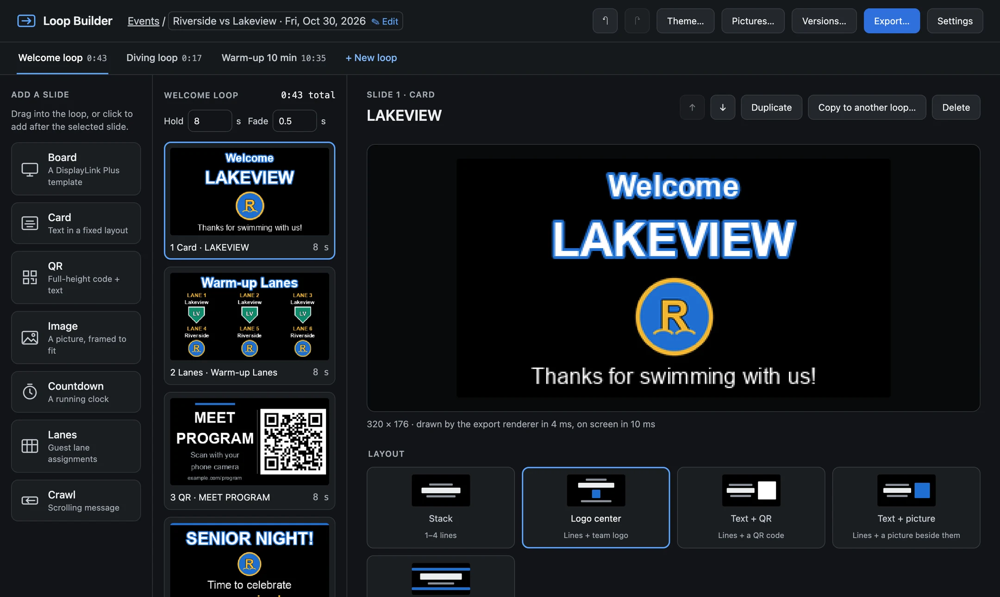
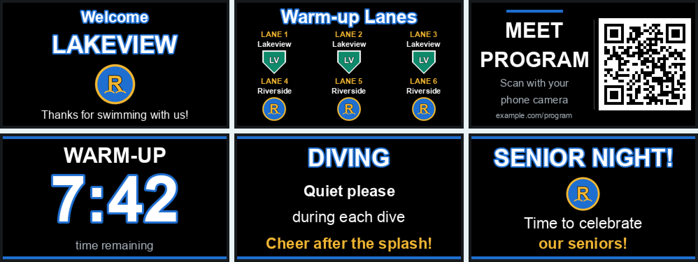

# Loop Builder

**Put your meet on the board.** Loop Builder makes the videos a pool scoreboard plays when it isn't showing
times: welcome screens, warm-up countdowns, lane assignments, meet program QR codes and thank-yous. It is free,
runs on Windows and on Macs with Apple silicon, and is built for DisplayLink Plus boards.

[Download the latest release](https://github.com/mhuot/loop-builder/releases/latest) ·
[See the project page](https://mhuot.github.io/loop-builder/)



Every slide below was drawn by Loop Builder at a board's real size, 320 × 176 pixels. The teams are made up.



## Problem

Swim and dive teams run their pool scoreboard with DisplayLink Plus. It shows race times and other information
from the timing system, and it can also play videos on a continuous loop: before the meet, between races, during
intermissions, after the meet, or any other time the board is free. Those loops carry welcome screens, diving
etiquette, warm-up countdowns and fundraiser slides. Each loop is a WMV at the board's exact pixel size. Making
them today takes image tools, a video encoder and a lot of trial and error, and the result only shows up on the
board.

## Features

- Seven slide types: Board (a DisplayLink Plus template), Card (text in five fixed layouts), QR, Image (with
  framing and an optional pan), Countdown, Crawl and Lanes (guest teams by lane, from a team library).
- A team theme in Settings (colors and logo) that every new event starts from; each event can change its own.
- One event file holds every loop for a meet, so next week's meet starts from this one.
- The preview is drawn by the same renderer as the export, so it matches the WMV pixel for pixel.
- Checks before export: QR codes decode to their links, lines fit, pictures are present.
- Export straight to WMV (wmv2, 30 fps) for DisplayLink Plus, plus an optional enlarged MP4 to review.
- An events home with starters (dual meet, Sections, True Team, blank), duplicate, and `.loopevent` packages
  for moving an event to another computer.
- A drag-and-drop editor: palette, slide strip, an editor per slide type, autosave, undo and redo, copying a slide
  to another loop, and versions kept on each export.
- Runs offline. Events, templates and pictures stay on the computer.

## Download

Get the latest Windows installer (or portable zip) and Mac .dmg from
[Releases](https://github.com/mhuot/loop-builder/releases/latest). Both are signed: the Windows files by
Mike Huot through Microsoft Artifact Signing, and the Mac app with an Apple Developer ID, notarized by Apple.
Loop Builder checks for a newer release when it starts and says so on the events page.

The Mac app needs a Mac with Apple silicon (M1 or later). It does not run on Intel Macs, and an Intel build is
not planned.

## Quick Start

```sh
python3.13 -m venv .venv
.venv/bin/pip install -r requirements-dev.txt
# the editor, in its app window, on the example event
.venv/bin/python -m app            # the events home; first launch asks for the DisplayLink Plus template folder
.venv/bin/python -m app examples/dual-meet/event.yaml --templates "<DisplayLink Plus template folder>"   # one event
# or straight to WMVs
.venv/bin/python -m loopgen examples/dual-meet/event.yaml --templates "<DisplayLink Plus template folder>" --out out
```

For working on the editor itself, `--browser` opens it in a browser tab instead, for reloading and dev tools.

The example's Board slides and countdown backgrounds are drawn from DisplayLink Plus templates (it uses
`Welcome - Meet Mobile.tpl`). They come with DisplayLink Plus, not with this repository, so without a template
folder those slides stop the export with "board template not found" and the folder that was searched.

## Architecture

- `loopgen/` renders slides and loops from an event file and encodes them with FFmpeg through PyAV.
  `tpl.py` and `nrbf.py` read DisplayLink Plus `.tpl` templates.
- `app/` is a local server (FastAPI, 127.0.0.1 only) and the editor page it serves. The packaged app shows
  that page in a pywebview window.
- `packaging/` builds the desktop app with PyInstaller as a folder app (`.app` on Mac, a folder with
  `Loop Builder.exe` on Windows).

## Details

- Build the app: `.venv/bin/pyinstaller packaging/loopbuilder.spec --noconfirm`; installers, signing and CI are
  in [packaging/README.md](packaging/README.md). The version is set in `app/version.py`.
- Events live in the Loop Builder folder: Documents › Loop Builder on Windows (the Documents Explorer shows, which
  OneDrive's folder backup may have moved; one an earlier version set up in the user folder's Documents stays), and
  Library › Application Support › Loop Builder on a Mac (so macOS doesn't ask to open Documents; 0.1.6 and earlier used Documents there too, and the
  events page offers to bring those over). Exports default to Movies › Loop Builder on a Mac. Set `LOOPBUILDER_HOME`
  to use another folder, as the tests do.
- Tests: `.venv/bin/python -m pytest`. Lint: `.venv/bin/pylint loopgen app tests packaging/*.py`. Format: `.venv/bin/black loopgen app tests packaging` (120 columns, set in `pyproject.toml`). CI checks both, so keep them clean.
- Pictures added to an event are kept as working copies at most 2048 px on the long side, so previews stay fast.

## Help and feedback

Report a problem or ask for a feature in [Issues](https://github.com/mhuot/loop-builder/issues). In the app,
Settings › About Loop Builder… has the version and these links. If something goes wrong in the packaged app,
`loop-builder.log` in the Loop Builder folder has the details (Documents › Loop Builder on Windows,
`~/Library/Application Support/Loop Builder` on a Mac; the events page's Show in Finder button opens it).

## Privacy

Loop Builder keeps your events, pictures and settings on your computer. It doesn't collect or send anything
about you or your events. At start it asks GitHub whether a newer release exists (`RELEASES_URL` in
`app/version.py`; set it to `None` to turn that off).

## License

Loop Builder is licensed under the [Apache License 2.0](LICENSE). Copyright 2026 Mike Huot.

The packaged app also includes third-party software under its own licenses, listed in
[THIRD_PARTY_NOTICES.md](THIRD_PARTY_NOTICES.md). PyAV's FFmpeg build includes the GPL x264 encoder, so the
packaged app as a whole is distributed under the GNU GPL v3; this repository is its complete source.
